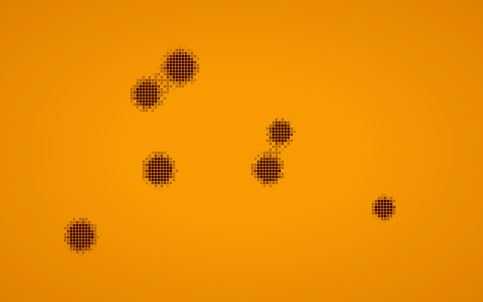
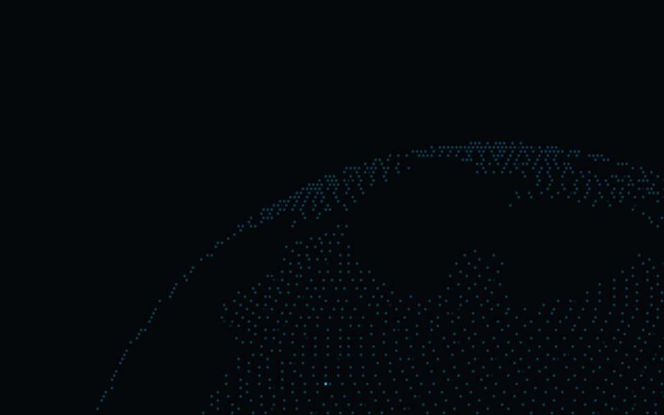
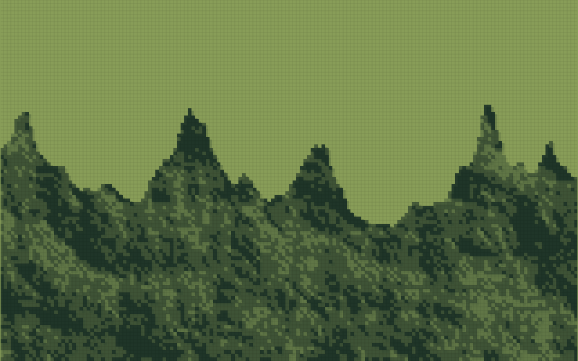
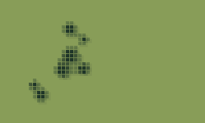

# pixel-backdrop

A live pixel-grid backdrop for a page. Canvas toys, shown through an emulated LCD.

[Demo](https://carterworks.github.io/pixel-backdrop/)





```sh
npm i @carterworks/pixel-backdrop
```

## Use

```html
<pixel-backdrop aria-hidden="true">
  <emulated-canvas data-width="160" data-height="160" data-fit="viewport"></emulated-canvas>
</pixel-backdrop>
```

```js
import "@carterworks/pixel-backdrop/pixel-backdrop.css";
import "@carterworks/pixel-backdrop";
```

Give it a display:

```js
document.querySelector("pixel-backdrop").display = {
  base: "#889d58",
  ink: "#263c2b",
  look: { levels: 4, gap: 2, ghostRise: 45, ghostFall: 30 },
};
```

Set `display` before the element is defined and its first frame is already in it.

- `setToy(id)` picks a toy from `TOYS` in `@carterworks/pixel-backdrop/toys`.
- `play(toy)` runs your own.
- `configure({ shape: "hex" })` changes a knob; `reset()` undoes it.
- The `--backdrop-*` custom properties in `pixel-backdrop.css` set the defaults.
- `--backdrop-page-color` is the colour a plain display paints its gaps in.

## Inline

`<emulated-canvas>` works on its own, anywhere in the page:



```html
<emulated-canvas
  data-width="50"
  data-height="30"
  data-scale="5"
  data-gap="1"
  data-palette-base="#889d58"
  data-palette-ink="#263c2b"
  data-palette-levels="4"
  style="--emulated-canvas-gap-color: #889d58"
></emulated-canvas>
```

```js
import "@carterworks/pixel-backdrop/emulated-canvas";
import { wax } from "@carterworks/pixel-backdrop/toys/wax";

wax.start(document.querySelector("emulated-canvas"));
```

## Elements

- `<emulated-canvas>` is a canvas stand-in. Draw on it with `getContext("2d")`. It shows the bitmap as magnified cells through a palette, noise and LCD ghosting.
- `<pixel-backdrop>` fixes an `<emulated-canvas>` behind the page, runs a toy on it, passes it the pointer and dissolves between toys.

The full API is in [`custom-elements.json`](custom-elements.json).

## Toys

A toy is `{ id, label, start(canvas) → stop }`. It runs on a plain `<canvas>` too:

```js
import { pond } from "@carterworks/pixel-backdrop/toys/pond";

const stop = pond.start(document.querySelector("canvas"));
```

## Develop

```sh
pnpm install
pnpm verify       # types, tests, manifest
pnpm build        # dist/
pnpm screenshots  # screenshots/
```

## License

MIT
